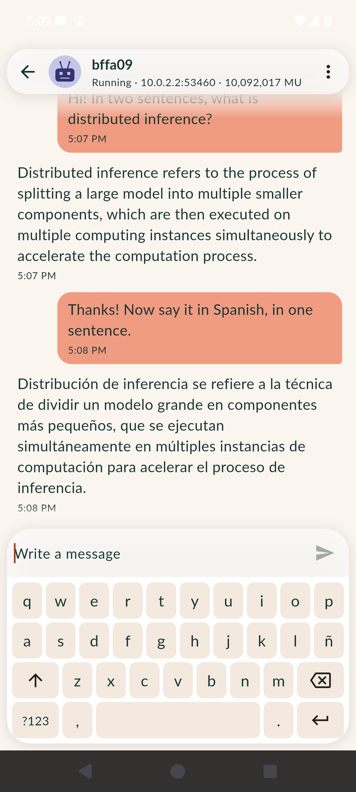

# distributed-llama

A Celaut chat service that runs a small open model with **distributed llama.cpp inference on
CPUs**. The head speaks the chat interface of chatui
([`docs/celaut/chat.md`](https://github.com/celaut-project/chatui/blob/master/docs/celaut/chat.md),
revision 6, gRPC over h2c), and llama.cpp splits the layers of the model across worker
instances that the head starts through the node.

It is also a test of how Celaut handles a distributed workload: children started and funded
by a parent, instance-to-instance traffic, delegation to a peer, and billing. The numbers are
in [BENCHMARK.md](BENCHMARK.md).

## Architecture

```
  chatui (phone)            node A                                    node A, or a peer B
 ┌────────────┐  tunnel   ┌───────────────────────────────────┐      ┌────────────────────────┐
 │ chat screen│──────────▶│ head (4 vCPU, 3 GiB)              │ RPC  │ worker 1 (4 vCPU, 2 GiB)│
 │            │  gRPC h2c │  :8080 chat.md rev 6 (Python)     │─────▶│  ggml-rpc-server :50052 │
 └────────────┘           │  llama-server 127.0.0.1:8081      │      └────────────────────────┘
                          │   --rpc w1:50052,w2:50052 -ngl 999│      ┌────────────────────────┐
                          │  model.gguf (only here, 1.1 GB)   │─────▶│ worker 2 ...            │
                          │  gateway client: StartService,    │      └────────────────────────┘
                          │  GetMetrics, ModifyDeposit, Stop  │
                          └───────────────────────────────────┘
```

- **head** (`head/`): the chat service. At start it reads `/__config__` (the gateway of the
  node), asks for `LLAMA_WORKERS` worker instances of the child service `worker` that the
  packer put in its image (`StartService`, funded per nodo #563), waits until each worker
  listens, then starts `llama-server --rpc <workers> -ngl 999`. llama.cpp gives each worker a
  share of the layers and sends it their tensors over the wire. The model file is only in the
  head. The chat answers stream token by token (`MessageDelta`).
- **worker** (`worker/`): `ggml-rpc-server` of llama.cpp, with one thread per vCPU. No Python,
  no model, no network.
- **llama.cpp** v0.8.0 (`8642541b`), built CPU-only in the image with `GGML_BACKEND_DL` and
  `GGML_CPU_ALL_VARIANTS` (one CPU backend per x86-64 level, chosen at run time), `GGML_RPC`.
  The build stage (`llama/build-stage.Dockerfile`) is the same text in both images.
- **model**: [Qwen2.5-1.5B-Instruct](https://huggingface.co/Qwen/Qwen2.5-1.5B-Instruct-GGUF)
  `q4_k_m` GGUF (Apache-2.0), revision `91cad511`, sha256 `6a1a2eb6…407e`, packed into the
  head: the service is sealed and needs no egress.

### Services

| Service | id (amd64) | Size with blocks | Resources (at_init = at_most) |
|---|---|---|---|
| `distributed-llama` (head), export `bffa09.celaut.bee` 1.45 GB | `bffa090f46b600718d130eef2bc7f9943529afdb49f8dcc9ed94908958e071b7` | 1.4 GiB (includes the worker) | 4 vCPU, 3 GiB RAM, 4 GB disk |
| `distributed-llama-worker` | `6f7dca757744a44fcfb528675667795e840b245f39869041bc86857e78c43ef8` | 112.5 MiB | 4 vCPU, 2 GiB RAM, 512 MiB disk |

The worker gets 2 GiB so that one worker can hold the whole model (about 1 GB of weights,
the KV cache of a 4096 context and the compute buffers).

## Run it

With nodo (as the operator of a node):

```sh
nodo import bffa09.celaut.bee        # the release asset (1.45 GB); it carries the worker
nodo execute bffa090f46b600718d130eef2bc7f9943529afdb49f8dcc9ed94908958e071b7 \
    --name chat -e LLAMA_WORKERS 2
nodo instances chat                  # the address of the slot 8080
```

The head answers the chat interface at once; the first answer waits (`PENDING`) until the
workers are up and the model is loaded. Any client of chat.md revision 6 works. From chatui:
run the service, then chat. A short check from a shell, with the stubs of `head/app`:

```sh
python3 bench/chatbench.py <ip>:8080 --text "Say hello."
```

**Stop the workers before the head.** A stop of the head from outside (`nodo kill`, the
`StopService` of a client) ends its VM at once, so the head cannot stop its workers, and nodo
does not stop the children of a killed instance. An orphan worker runs until its balance
ends, and the node marks that balance as lost (`refund` with `{"lost": "father_gone"}`). The
head funds its workers 5 minutes at a time to keep that loss small. `bench/run_case.sh` kills
the workers first.

### Environment variables

| Variable | Default | Meaning |
|---|---|---|
| `LLAMA_WORKERS` | `2` | Worker instances. `0`: the model runs on the head alone |
| `LLAMA_MAX_TOKENS` | `512` | The most tokens of one answer |
| `LLAMA_SYSTEM_PROMPT` | a short one | The system prompt |
| `LLAMA_TEMPERATURE` | `0.7` | Sampling temperature (`0` = greedy) |
| `LLAMA_SEED` | `42` | Sampling seed |
| `LLAMA_CTX` | `4096` | Context of the model; the history is cut to fit it |
| `LLAMA_THREADS` | vCPUs of the head | Threads of llama-server |
| `LLAMA_NGL` | `999` | `-ngl` of llama-server: the layers on the workers (`999` = all). llama.cpp v0.8.0 offloads the output layer first, so the logits always come back from a worker |
| `LLAMA_IGNORE_EOS` | off | For benchmarks: every answer has `LLAMA_MAX_TOKENS` tokens |
| `WORKER_FUNDED_SECONDS` | `300` | Runtime that a worker gets at the start, on top of its build |
| `WORKER_TOPUP_BELOW_SECONDS`, `WORKER_TOPUP_SECONDS` | `150`, `300` | The head tops a worker up (ModifyDeposit) when its balance is below the first, by the second |
| `WORKER_START_TIMEOUT_S`, `WORKER_READY_TIMEOUT_S` | `900`, `300` | Waits for funds and for a worker to listen |
| `WORKER_START_RETRIES` | `3` | Tries again a worker start that fails (not for funds) |

The first three are declared in `service.json` (chatui asks for them); the others can be set
with `-e` too (nodo delivers every variable of the start).

### What the head does when a worker fails

- A worker that does not start or does not listen: the head starts with the workers that
  came up, or alone, and says so at the start of the first answer.
- A worker that stops later: llama.cpp's RPC backend aborts, so the answer in progress ends
  `FAILED` with an `error`. The head stops the other workers, starts llama-server alone, and
  the next answer begins with a note: *"(worker 2 stopped. The model now runs on the head
  only, without workers)"*.
- The head checks each worker every 30 s with `GetMetrics`; an instance the node no longer
  knows counts as stopped.

Each answer carries its measures in `Message.metadata` (the client ignores them): llama.cpp
timings (`prompt_tps`, `gen_tps`, `ttft_ms` …), the mode (`distributed`, `local`,
`degraded`), the bytes on the network of the head during the answer and while the model
loaded, and the boot marks.

## Security

- **The llama.cpp RPC protocol has no authentication and no encryption.** Anyone who reaches
  the port of a worker can use its CPU and memory and read the tensors it holds. The worker
  declares no network; on one node, nodo lets only the parent reach the port of a child
  (`network.ISOLATE_INTERNAL_CHILDREN`, isolated bridge ports). When the node gives a worker
  to a peer, the peer publishes the port on its own address (or the node tunnels to it,
  `network.DELEGATION_TUNNEL_POLICY`): then the RPC traffic crosses the network between the
  nodes in clear text, and anyone on that path can reach the worker. Use delegation only
  between nodes on a network that you trust.
- llama-server listens on 127.0.0.1 inside the head only.
- The head and the worker run as an unprivileged user (uid 10001) inside their VMs.

## Layout

```
head/app/                 the head (chat.md rev 6 server, llama-server client, workers, gateway)
head/runtime.Dockerfile   the head image after the build stage
head/amd64/               pack root: .service/{Dockerfile,service.json,pack_config.json},
                          app -> ../app, worker -> ../../worker/amd64
worker/runtime.Dockerfile, worker/amd64/   the worker
llama/build-stage.Dockerfile   llama.cpp, the same stage in both images
proto/chat.proto          chatui master 163e348e (chat.md revision 6, round 8)
scripts/                  gen_proto.sh (stubs), gen_dockerfiles.sh (pack-root Dockerfiles)
bench/                    benchmark: chatbench, run_case, host_baseline, two-node/, summarize
tests/                    the chat interface with a fake model, the layout
```

Pack: `nodo pack head/amd64 --local` (it packs the worker as a dependency). Tests:
`python3 -m pytest tests` with `requirements-dev.txt`.

## Benchmark

See [BENCHMARK.md](BENCHMARK.md) for the method and all the numbers.

Alienware (Ryzen 5 5600X, WSL2, 12 vCPU), Qwen2.5-1.5B Q4_K_M, 359-token prompt, 128
tokens, 4 threads per instance, medians of 3 runs:

| case | pp tok/s | tg tok/s | TTFT s | cold start s | MU per run |
|---|---|---|---|---|---|
| plain llama.cpp (llama-bench) | 162.9 | 33.1 | - | - | - |
| host, no Celaut, head alone | 162.3 | 30.8 | 2.21 | 1.6 | - |
| Celaut, one node, head alone | 157.6 | 29.7 | 2.29 | 32.2 | 0.22 M |
| Celaut, one node, 1 / 2 / 3 workers | 163 / 154 / 152 | 27.9 / 26.1 / 24.9 | 2.2–2.4 | 41 / 52 / 54 | 0.5 / 0.8 / 1.2 M |
| Celaut, two nodes (workers on a peer), 1 / 2 / 3 | 171 / 168 / 163 | 28.4 / 26.8 / 25.6 | 2.1–2.2 | 64 / 60 / 85 | 10.6 / 20.9 / 31.7 M |

More workers make one conversation slower on CPUs (a pipeline: one round trip per worker
per token), as expected from llama.cpp RPC; Celaut adds a few % at run time, ~25 s of
instance start, and the two-node cost is mostly a build that the delegating node charges
but nobody did. Details and findings in [BENCHMARK.md](BENCHMARK.md).

From chatui (AVD, our node, 2 workers):



## Limitations

- CPU only, amd64 only. The model is small (1.5 B parameters, Q4_K_M): the point is the
  behaviour of Celaut, not the quality of the answers.
- llama.cpp RPC is a pipeline: the layers of one token run on one worker after the other, so
  more workers add memory, not speed, for one conversation. Each token costs one round trip
  per worker (and, with `-ngl 999`, the logits of the whole vocabulary, about 600 KB, come
  back from the last worker).
- One instance is one conversation, and llama-server has one slot: answers are made one after
  the other.
- Text only (`accepted_mime_types` is empty, `FileService` is not implemented).
- A stop of the head from outside leaves its workers running until their balance ends (see
  above). nodo could stop the children of a killed instance.

## Next steps

- GPU workers (`GGML_CUDA` worker variant) and a head that places layers by the memory and
  speed that each worker reports.
- arm64 pack roots (the Dockerfiles have no amd64-only step; the CPU variants differ).
- Workers across several peers, and a larger model that does not fit one node.
- An authenticated RPC transport between head and workers (a TLS or WireGuard wrapper, or a
  nodo tunnel), before delegation over untrusted networks.

## License

MIT (the license of llama.cpp). The model is Apache-2.0 (Qwen2.5).
